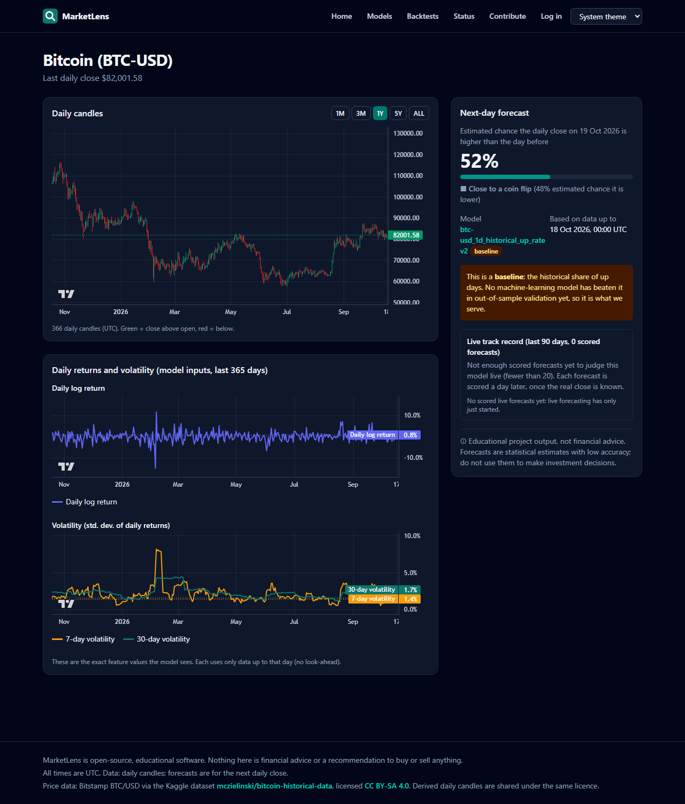
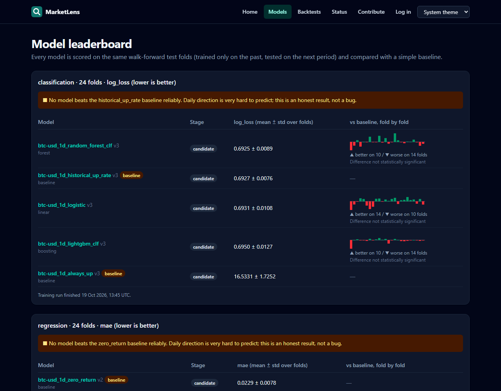
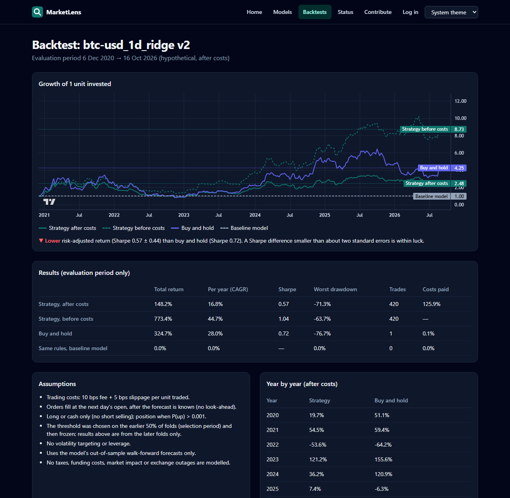
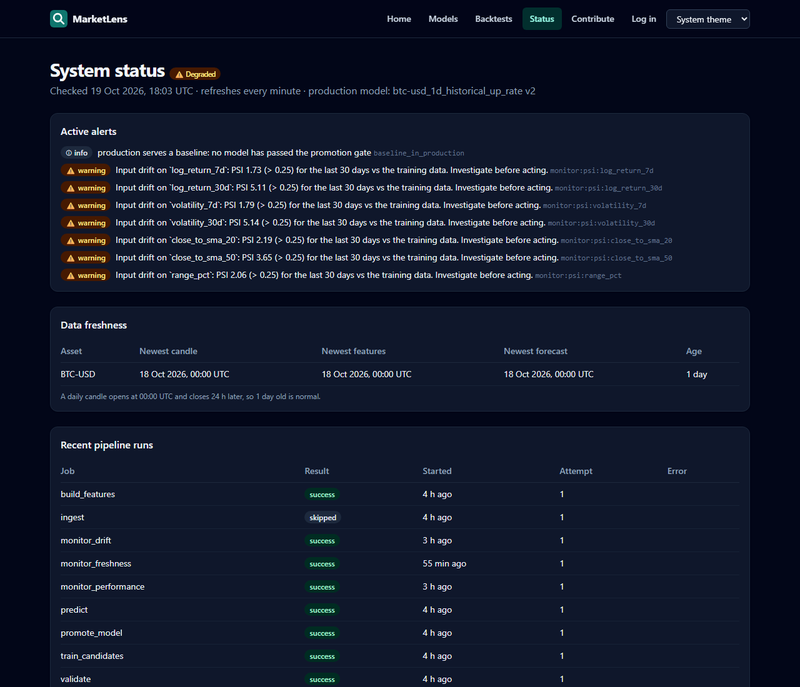
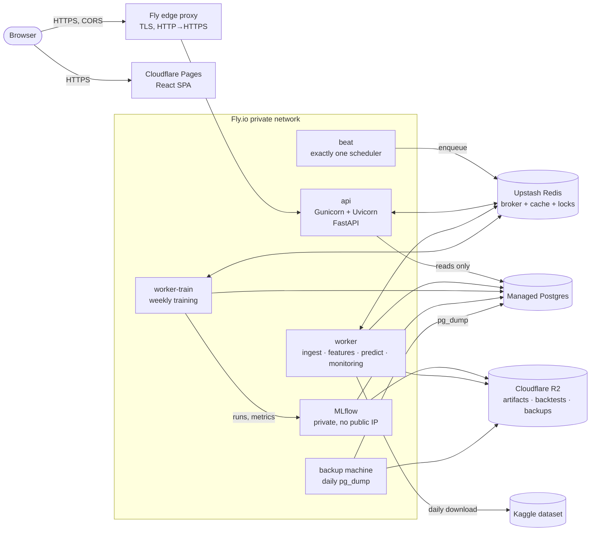

# MarketLens

[](https://github.com/strixxx9129/Market-Intelligence/actions/workflows/ci.yml)
[](https://github.com/strixxx9129/Market-Intelligence/actions/workflows/cd.yml)
[](https://github.com/strixxx9129/Market-Intelligence/actions/workflows/codeql.yml)
[](LICENSE)

Open-source **Market Intelligence & ML Monitoring Platform**. It ingests historical Bitcoin data,
builds leakage-free features, trains and compares ML models with walk-forward validation,
backtests strategies after costs, monitors data and model health, and serves everything through a
public API and a website. New data connectors, features and models plug into registries.

> **Educational software, not financial advice.** MarketLens shows estimated probabilities next to
> their track record and simple baselines. Nothing it produces is a recommendation to buy or sell.

**The honest headline:** after 24 walk-forward folds (2013–2026), no ML model beats a simple
"historical share of up days" baseline at predicting Bitcoin's next-day direction, so production
serves the baseline and says so. That's the point of the project: measure honestly, publish the
result, and make it easy for anyone to try to do better.

| Overview and forecast | Model leaderboard vs baseline |
|---|---|
| [](docs/images/asset.png) | [](docs/images/models.png) |
| **Backtest after costs vs buy-and-hold** | **System status and monitoring** |
| [](docs/images/backtest.png) | [](docs/images/status.png) |

## What's inside

- **Data:** idempotent ingestion with connector plugins, validation and quarantine; raw file
  hashes; UTC everywhere.
- **Features:** a versioned feature store; every feature passes a truncation test (no look-ahead).
  See the [feature catalog](docs/feature-catalog.md).
- **Models:** walk-forward validation with a gap, baselines first, MLflow tracking, immutable model
  versions, and a promotion gate. See the [experiment report](docs/experiment-report.md).
- **Backtests:** threshold chosen on earlier folds only, fees and slippage, compared with buy-and-hold
  and the baseline. See the [backtest report](docs/backtest-report.md).
- **Pipeline:** Celery with retries, locks and a per-attempt audit trail; Beat schedules the daily
  forecast and weekly retraining.
- **API:** versioned, cached, rate limited; JWT and API keys; every forecast carries
  `model_version`, `as_of_ts` and a disclaimer.
- **Monitoring:** freshness, PSI/KS drift, live log loss vs expectations, deduplicated alerts,
  Prometheus, Grafana and Sentry.
- **Website:** charts, forecast panel with track record, leaderboard, **model cards**
  (`/models/<id>` on the site, `GET /api/v1/models/{id}` in the API), backtests and status.
- **Operations:** CD to Fly.io and Cloudflare Pages, daily backups with a tested restore drill,
  and runbooks.

## Architecture



The API never trains models or calls external sources during a request; it only reads
precomputed rows from PostgreSQL and Redis. Code layering is routers (HTTP only) → services
(logic) → repositories (SQL only); Celery tasks call the same services. Each design decision
has an ADR in [docs/adr/](docs/adr/).

## Quick start (local)

Requirements: **Docker** (Compose v2) and **make**. On Windows: `winget install ezwinports.make`,
or use Git Bash / WSL.

```bash
cp .env.example .env
make up          # build and start everything (waits until healthy)
make migrate     # create the schema
make seed        # reference assets
make data        # download the Kaggle dataset (needs ~/.kaggle token)
make daily SYNC=1    # ingest → validate → features → predict
make weekly SYNC=1   # train candidates → promotion gate
```

| Service | URL |
|---|---|
| **Website** | http://localhost:5173 |
| API docs (Swagger) | http://localhost:8000/docs |
| MLflow | http://localhost:5000 |
| Grafana (`admin` / `GRAFANA_ADMIN_PASSWORD`) | http://localhost:3001 |
| Prometheus | http://localhost:9090 |

**Done means `make lint` and `make test` pass.** They cover the backend (ruff, mypy strict,
pytest) and the frontend (ESLint, Prettier, tsc, Vitest). `make help` lists every target.

<details>
<summary>Everyday commands</summary>

| Area | Commands |
|---|---|
| Data | `make ingest MODE=full\|incremental`, `make features`, `make feature-catalog` |
| Models | `make train TASK=classification`, `make report`, `make backtest MV=<id>`, `make backtest-report` |
| Pipeline | `make daily`, `make weekly`, `make runs`, `make retry RUN=<id>`, `make backfill START=… END=…` |
| API | `make loadtest`, `make openapi` (export the schema for the frontend) |
| Website | `make web`, `make web-gen`, `make web-test`, `make web-build` |
| Ops | `make backup`, `make restore-drill`, `make changelog TAG=vX.Y.Z` |
| EDA | `make notebook`, `make eda` ([findings](docs/eda-report.md)) |

API access: anonymous reads are limited to 60/min per IP. Register, then create a key under
`/api/v1/me/api-keys` and send it as `X-API-Key` (1000/min). First admin:
`docker compose -f infra/docker-compose.yml --env-file .env run --rm api marketlens admin create-user --email you@example.org --role admin`.
</details>

## Deployment

Every merge to `main` runs [CD](.github/workflows/cd.yml):

1. Tests.
2. Images pushed to GHCR, tagged with the commit SHA.
3. **Staging:** migrations run as Fly's release step, then a rolling deploy, then the site deploy
   to Pages, then a smoke test.
4. **Production:** the same steps, after a required approval.

Setup is in [docs/runbooks/first-deploy.md](docs/runbooks/first-deploy.md) and the design is in
[ADR 0012](docs/adr/0012-deployment.md). Production config refuses to start if any secret is
missing or unsafe. `infra/docker-compose.prod.yml` runs the same images on a single VM
behind Caddy.

Runbooks: [first deploy](docs/runbooks/first-deploy.md) ·
[restore a backup](docs/runbooks/restore.md) ·
[failed ingestion](docs/runbooks/failed-ingestion.md) ·
[model rollback](docs/runbooks/model-rollback.md) ·
[cache flush](docs/runbooks/cache-flush.md).

## Security

- HTTPS only, with HSTS.
- Strict CORS: an explicit `https://` origin list.
- CSP and security headers on both the API and the site.
- Per-IP rate limits that use the platform's unforgeable client-IP header.
- Non-root, minimal images, with SBOM and provenance.
- Secrets live only in the platform secret stores.
- Dependabot and CodeQL.
- Reporting a vulnerability: please open a private
  [security advisory](https://github.com/strixxx9129/Market-Intelligence/security/advisories/new),
  not a public issue.

## Data and licences

Code: [Apache-2.0](LICENSE). Price data: Bitstamp BTC/USD via the Kaggle dataset
[mczielinski/bitcoin-historical-data](https://www.kaggle.com/datasets/mczielinski/bitcoin-historical-data),
licensed [CC BY-SA 4.0](https://creativecommons.org/licenses/by-sa/4.0/). The daily candles
MarketLens derives from it are shared under the same licence; the API and website show this
attribution. Raw data is never committed.

## Repository layout

```
backend/   FastAPI app, Celery tasks, ML (package `marketlens`), Alembic, tests
frontend/  React + TypeScript website (Vite, TanStack Query, Lightweight Charts)
infra/     docker-compose (dev and prod), Fly.io configs, Prometheus/Grafana, backup image
scripts/   backup/restore/drill, OpenAPI export, smoke test, feature catalog
docs/      PROGRESS, ADRs, runbooks, reports, feature catalog
```

## Contributing

New features, models and connectors are welcome; they plug in without touching the core. See
[CONTRIBUTING.md](CONTRIBUTING.md) and the website's Contribute page. Progress and decisions:
[docs/PROGRESS.md](docs/PROGRESS.md), [CHANGELOG.md](CHANGELOG.md).
