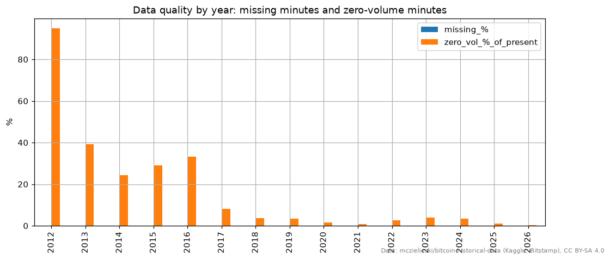
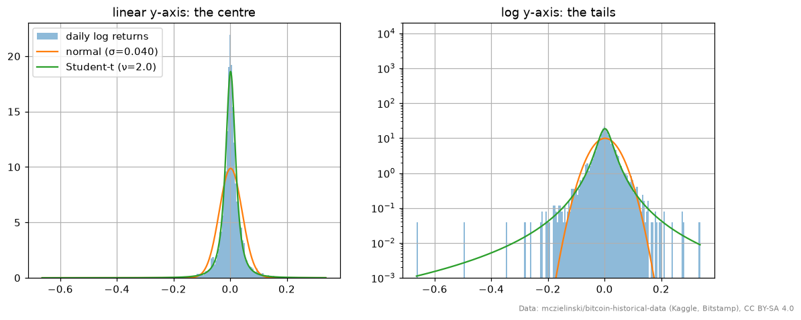
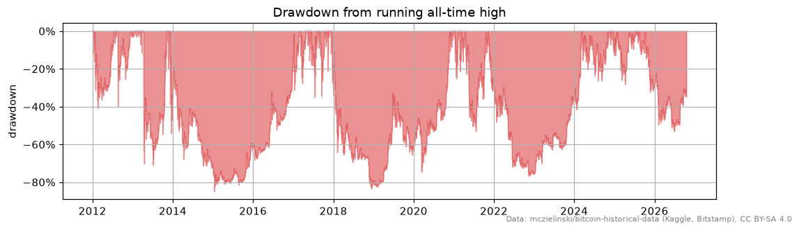
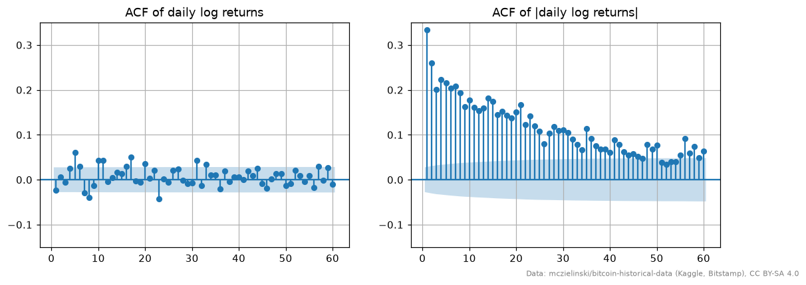
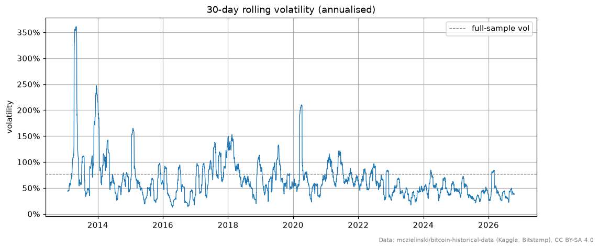
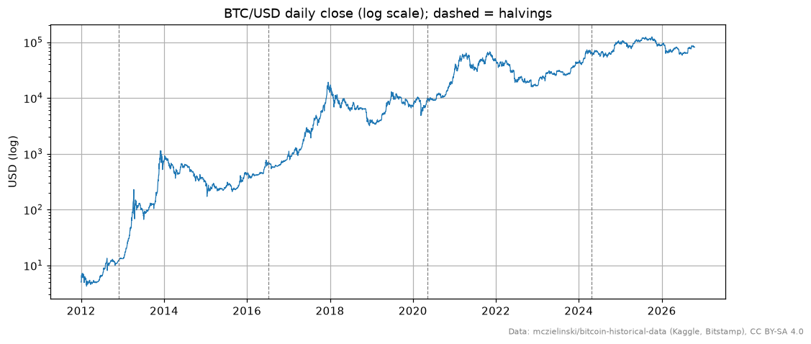

# EDA report: Bitcoin daily data

- **Notebook:** [`notebooks/01_eda.py`](../notebooks/01_eda.py) (reproduce with `make data && make eda`)
- **Data:** Kaggle [`mczielinski/bitcoin-historical-data`](https://www.kaggle.com/datasets/mczielinski/bitcoin-historical-data),
  Bitstamp BTC/USD 1-minute OHLCV, licence **CC BY-SA 4.0**. File `btcusd_1-min_data.csv`,
  SHA-256 `0d0421833cfb115f86f65433cf4b0298d151980860e763ac754d0b7ace10ce3a`, retrieved 2026-10-18.
- **Coverage:** 7,781,879 minutes, 2012-01-01 → 2026-10-18 → 5,404 complete UTC days.
  Return statistics use **2013-01-02 → 2026-10-17 (5,037 daily log returns)**; see finding 1.

> Educational analysis, not financial advice. Nothing here suggests buying or selling anything.

---

## Summary

| # | Finding | Modelling implication |
|---|---|---|
| 1 | Gaps are hidden as zero-volume "flat-fill" rows; 2012 is ~95% fills | Measure data quality by *traded* minutes; start training in 2013 |
| 2 | The minute data is otherwise clean | Keep these checks as automated validation (Pandera) in ingestion |
| 3 | Price is non-stationary; log returns are stationary | Model returns (or other scale-free transforms), never raw price |
| 4 | Fat tails: 18 days beyond 5σ where a normal predicts ~0 | Use MAE/quantile losses, robust scaling; don't trust Gaussian risk numbers |
| 5 | Negative skew: crashes are bigger than rallies | Evaluate downside separately; symmetric metrics hide crash risk |
| 6 | Strong volatility clustering in every era | Volatility is forecastable: rolling-vol / |return| features, vol targets |
| 7 | Return autocorrelation is weak and has faded over time | Expect direction accuracy near 50%; a naive baseline is mandatory |
| 8 | Regimes: volatility and tail size changed a lot across eras | Walk-forward validation; per-era metrics; periodic retraining |
| 9 | Halving cycles and >80% drawdowns dominate the price path | Few independent "cycles" means a small effective sample; beware overfitting |

---

## 1 · Missing data is disguised as zero-volume rows

**Evidence.** The file contains **every** minute from first to last timestamp: no duplicates,
no gaps (`expected = present = 7,781,879`). But **1,312,416 rows (16.9%) have zero volume**,
and *all* of them are flat (open = high = low = close): the last price carried forward.
The share of fill rows collapses over time: **95% in 2012**, 39% in 2013, 24–33% in
2014–2016, under 4% since 2018, 0.4% in 2026. 192 days in 2012 had less than one hour of real
trading. [`eda_quality_by_year.png`](figures/eda_quality_by_year.png)

**What it means.** A row-count check would say the data is perfect. In reality, in early years
most "prices" are not market observations. Returns computed from them are artificial zeros,
which make the market look calmer and more predictable than it was.

**Implication.** Data-quality metrics must count **traded minutes**, not rows. The saved daily
series carries `minutes_traded` and a `low_coverage` flag. Training and evaluation start on
**2013-01-01**. The ingestion phase should store volume-based coverage per day so this is
visible in monitoring.

## 2 · Otherwise the minute data is clean

**Evidence.** 0 NaNs, 0 duplicate timestamps, all timestamps on whole minutes and sorted,
**0 OHLC violations** (`low ≤ open, close ≤ high`), 0 non-positive prices, 0 negative volumes.
The five largest daily moves (2013-04-11 −48.5%, 2013-11-18 +40.1%, 2020-03-12 −39.0%, …)
are documented market events with near-full trading coverage, not bad ticks.

**What it means.** The data can be used without row-level repairs; the main issue is
finding 1, not corruption.

**Implication.** Turn these exact checks into a **Pandera schema** in the ingestion phase, so
any future download that breaks them is rejected before it reaches `market_prices`. Extreme
returns are kept, not clipped: they are real, and they are exactly what risk metrics must see.

## 3 · Price is non-stationary; returns are stationary

**Evidence.** Augmented Dickey-Fuller test (H0 = unit root / non-stationary):

| series | ADF stat | p-value | 5% critical |
|---|---|---|---|
| price | −1.01 | 0.75 | −2.86 |
| log price | −2.61 | 0.09 | −2.86 |
| daily log return | −13.25 | 9 × 10⁻²⁵ | −2.86 |

Log returns sum exactly to the total log price change (8.7252 = ln(P_T/P_0)).

**What it means.** Price wanders without a fixed mean: a level learned in 2017 ($10k) says
nothing about 2026 ($80k). Returns have a stable mean around zero, so relationships learned in
one period can carry over to another.

**Implication.** Targets and features must be **scale-free**: log returns, ratios such as
price / moving average, z-scores, volatility. Never feed raw price levels into a model;
tree models in particular cannot extrapolate beyond the price range they saw in training.

## 4 · Returns have extremely fat tails

**Evidence.** Daily log-return σ = 4.0%, excess kurtosis **26.3** (normal = 0), Jarque-Bera
p ≈ 0. Under a fitted normal:

| | observed days | expected if normal |
|---|---|---|
| \|z\| > 3 | 78 | 13.6 |
| \|z\| > 4 | 37 | 0.3 |
| \|z\| > 5 | 18 | ≈ 0 |

A Student-t fits far better, with **ν ≈ 2**: so fat-tailed that the variance estimate itself is
unstable. [`eda_return_hist.png`](figures/eda_return_hist.png)

**What it means.** "Once in 10,000 years" events happen several times per cycle. A handful of
days dominate means, variances and squared-error losses.

**Implication.**
- Prefer **MAE / Huber / quantile losses** over MSE when training regressors, and report
  median-based metrics next to means.
- Use robust scaling (median/IQR) in pipelines.
- Risk numbers that assume normality (σ-based VaR) will badly understate losses; the backtest
  phase should report historical drawdowns and tail quantiles.

## 5 · Negative skew: crashes are larger than rallies

**Evidence.** Skewness **−1.31**. The largest down day (−48.5% simple, −66.4% log) is bigger
than the largest up day (+40.1%). Maximum drawdown from the all-time high is **−84.9%**
(2015-01-14); drawdowns of −70% to −85% recur in 2014–15, 2018 and 2022.
[`eda_drawdown.png`](figures/eda_drawdown.png)

**What it means.** Losses arrive suddenly and in size; gains tend to accumulate more gradually.

**Implication.** Metrics must look at the **downside separately**: hit rate alone or symmetric
error can look fine while a model misses every crash. Backtests report max drawdown and worst
day by default. (Skew has shrunk to −0.12 in 2021–2026; see finding 8.)

## 6 · Volatility clusters strongly, in every era

**Evidence.** Autocorrelation of |returns| is **0.33 at lag 1, 0.18 at lag 10, 0.11 at lag 30**,
and stays above the significance band for 60 days. Ljung-Box on |returns| p ≈ 0 at every lag.
30-day annualised volatility ranges from **13% to 361%** (median 57%), and calm or wild
periods each last months. Per era, lag-1 ACF of |returns| is 0.49 / 0.18 / 0.16, so the effect
persists in the mature market. [`eda_acf.png`](figures/eda_acf.png),
[`eda_rolling_vol.png`](figures/eda_rolling_vol.png)

**What it means.** The *size* of tomorrow's move is predictable from recent move sizes, even
though its *direction* mostly is not (finding 7). This is the most reliable structure in the data.

**Implication.**
- Strong feature candidates: rolling volatility (7/30/90 d), |return| lags, high–low range,
  volatility ratios.
- Predicting **volatility** (or "big move vs not") is a more realistic ML target than
  predicting direction.
- Use volatility-scaled targets/positions, and always report metrics per volatility regime.

## 7 · Return autocorrelation is weak and fading

**Evidence.** Lag-1 autocorrelation of daily returns **−0.023** (Ljung-Box lag-1 p = 0.11, not
significant). Over 10 lags the joint test is significant over the whole sample (p ≈ 10⁻⁷), but
individual coefficients are tiny (largest ≈ 0.06 at lag 5). The effect **fades over time**:
Ljung-Box(10) p = 0.000 in 2013–2016, 0.043 in 2017–2020, **0.094 in 2021–2026**. Caveat: the
standard ACF bands assume constant variance, so with clustering (finding 6) they make
autocorrelation look more significant than it is.

**What it means.** Yesterday's return says almost nothing about today's direction, and the
small effect that existed in the young, illiquid market has mostly disappeared, consistent with
a market becoming more efficient.

**Implication.**
- Expect directional accuracy **close to 50%**. Every model must beat **naive baselines**
  (always-up, last-return sign, zero-return forecast) under the same walk-forward splits.
- An apparent edge of a few points can vanish after transaction costs; the backtest phase must
  include costs.
- Accuracy far above ~55% on daily direction should be treated as a **leakage alarm**, not
  a success.

## 8 · Regimes: the market's statistics changed substantially

**Evidence.** Per era (daily log returns):

| era | annual vol | skew | excess kurtosis | ACF(1) \|r\| | Ljung-Box(10) p, returns |
|---|---|---|---|---|---|
| 2013–2016 | 95% | −1.81 | 30.7 | 0.49 | 0.000 |
| 2017–2020 | 83% | −1.00 | 14.0 | 0.18 | 0.043 |
| 2021–2026 | 57% | −0.12 | 4.1 | 0.16 | 0.094 |

Median 30-day volatility fell from 92% (2013) to 40% (2025–2026). Yearly |return| and
volatility are strongly linked (corr 0.85 across years). Yearly returns range from −73% (2018)
to +5,437% (2013).

**What it means.** The data is not one stationary process but a sequence of regimes:
an illiquid early market, boom-and-bust cycles, and a calmer, more institutional period.
Fat tails and clustering persist throughout; their *magnitude* does not.

**Implication.**
- **Walk-forward validation is mandatory** (rule 1); a random split would mix 2013 and 2025
  and hide regime change.
- Report metrics **per fold / per era**, not only the pooled average.
- Use a gap between train and test windows, and consider limiting or down-weighting the oldest
  data.
- Plan for periodic retraining; drift monitoring (a later phase) should track rolling
  volatility and the return distribution.

## 9 · Long cycles mean few independent samples

**Evidence.** On a log scale, the price path is dominated by multi-year boom/bust cycles that
roughly line up with the four supply halvings (2012, 2016, 2020, 2024), each followed by a deep
drawdown. [`eda_price_log.png`](figures/eda_price_log.png)

**What it means.** 5,000 daily rows contain only about **3–4 complete market cycles**. Many
features (trend, momentum) are highly correlated within a cycle, so the effective number of
independent observations is far smaller than the row count. (Halving alignment is an
observation about four events, not a tested causal effect.)

**Implication.** Keep models small and regularised; prefer few, well-motivated features;
judge results on how consistent they are across walk-forward folds rather than on one
impressive number; treat any cycle-based feature with suspicion.

---

## Decisions carried into the next phases

1. The modelling sample starts **2013-01-01**; daily bars are UTC days; the unfinished current
   day is always excluded.
2. Targets are built from **log returns**; features must be scale-free.
3. Validation is **walk-forward with a gap**, with per-fold and per-regime reporting.
4. Baselines (zero-return, last-sign, always-up) are a required part of every model comparison.
5. Ingestion stores traded-minute coverage, and validation reuses the quality checks above.

*Figures: generated by the notebook into `docs/figures/`.
Data: mczielinski/bitcoin-historical-data (Kaggle, Bitstamp), CC BY-SA 4.0. Derived figures and
statistics in this report are shared under the same licence.*
